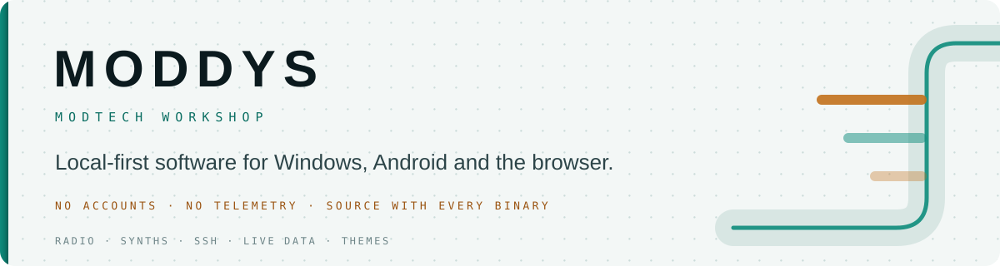
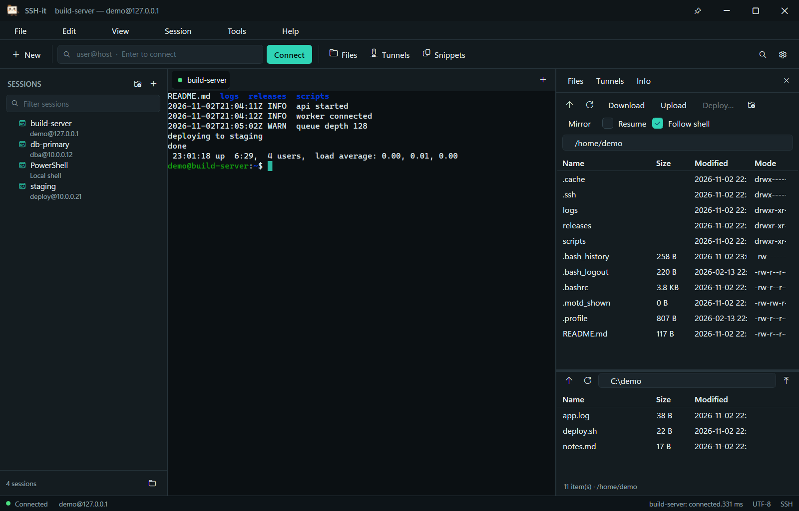
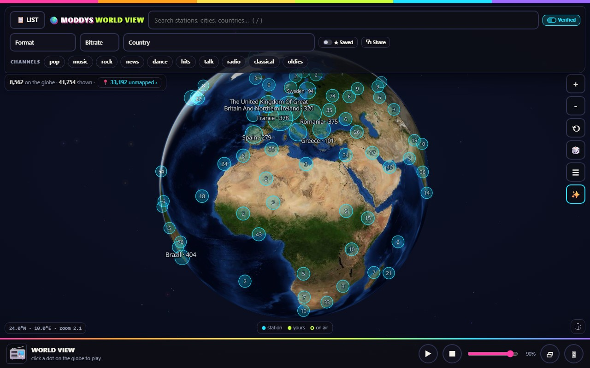
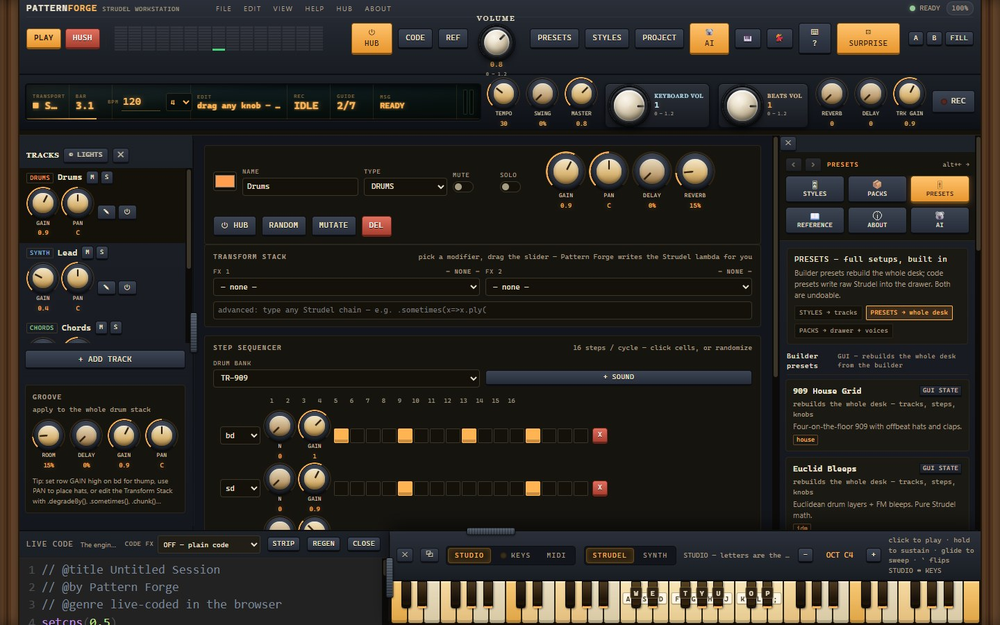
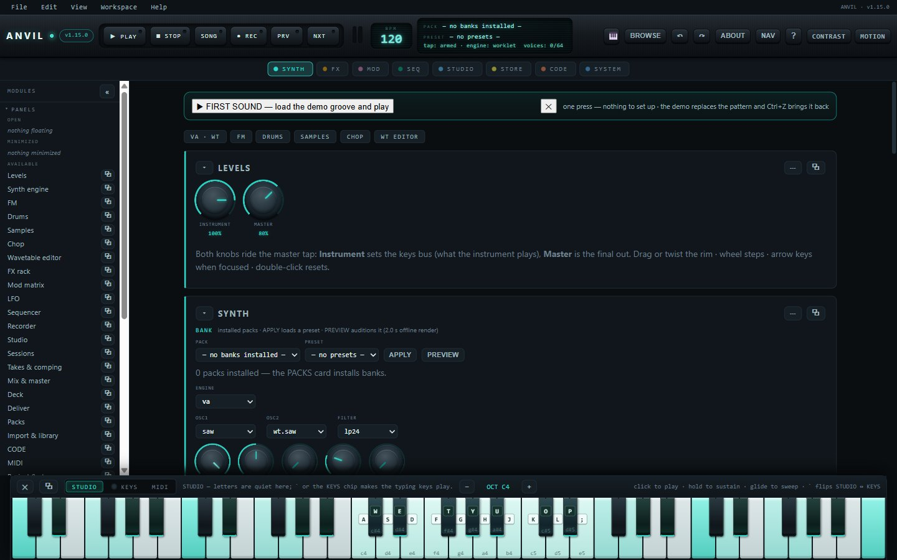

<picture>
  <source media="(prefers-color-scheme: dark)" srcset="https://raw.githubusercontent.com/ModdySwag/ModdySwag/main/assets/hero-dark.svg">
  <source media="(prefers-color-scheme: light)" srcset="https://raw.githubusercontent.com/ModdySwag/ModdySwag/main/assets/hero-light.svg">
  
</picture>

 

  
  
  
  

## The short version

I build small, sharp tools and give them away. A Windows SSH workspace. A pocket radio with
71,577 stations. Synthesizers that live in a browser tab. A registry that keeps the world's
public live cameras honest. Most of it is Windows and web, some of it is Android and iOS, and
all of it is local-first: the program on your machine does the work, and there is no account
to create.

Everything here is built and maintained by one person, which is why the READMEs are long and
the feature lists are short.

## Start here

<table>
  <tr>
    <td width="46%" valign="top"></td>
    <td width="54%" valign="top"><strong>SSH-it</strong> — a native Windows SSH workspace that drives the real OpenSSH client.  ConPTY terminal with a full VT parser, split panes and broadcast, an SFTP panel with dual panes, resume and mirror, jump chains with per-hop keys, MFA through the pane, and a session store that is just JSON files you can read. MIT.  <code>Windows</code> · <code>C# / .NET</code> · <a href="https://github.com/ModdySwag/SSH-it/releases">Releases</a></td>
  </tr>
  <tr>
    <td width="46%" valign="top"></td>
    <td width="54%" valign="top"><strong>MODDYS World Radio &amp; Podcasts</strong> — 71,577 live stations plus a 58,795-show podcast directory, on Android and iOS.  Keeps playing with the screen off and the app in the background, puts the station on your lock screen, and doesn't lose the ~11,600 stations that still stream over plain <code>http://</code>. Both apps ship the same shell script as the site, byte for byte.  <code>Android</code> · <code>iOS</code> · <a href="https://github.com/ModdySwag/world-radio-and-podcasts-android/releases">Android</a> · <a href="https://github.com/ModdySwag/world-radio-and-podcasts-ios/releases">iOS</a></td>
  </tr>
  <tr>
    <td width="46%" valign="top"></td>
    <td width="54%" valign="top"><strong>Pattern Forge</strong> — a live-coding music workstation built on <a href="https://strudel.cc">Strudel</a>.  A full GUI over the TidalCycles pattern language: a pattern editor with its own library of ready patterns, instruments and a mixer, recording and export, and a Windows build that runs the same code as the site. 26,000+ lines of hand-written HTML, CSS and JS, no framework. AGPL-3.0.  <code>Windows</code> · <code>web</code> · <a href="https://moddys.net/forge/">Play in the browser</a> · <a href="https://github.com/ModdySwag/PatternForge/releases">Releases</a></td>
  </tr>
  <tr>
    <td width="46%" valign="top"></td>
    <td width="54%" valign="top"><strong>Anvil</strong> — a synth and groovebox in a single <code>index.html</code>.  Acid, wavetable, FM, string, drum, granular and sampler engines; a step sequencer with chains, song rows and scenes; a seven-slot FX rack with drag-to-modulate matrix; 10 packs and 580 presets; a recording desk that exports WAV, stems, MIDI and song bundles. 94,000+ lines, no framework, no bundler beyond its own build script. AGPL-3.0.  <code>Windows</code> · <code>web</code> · <a href="https://moddys.net/anvil/">Play in the browser</a> · <a href="https://github.com/ModdySwag/Anvil/releases">Releases</a></td>
  </tr>
</table>

## The rest of the shelf

| Project | What it is | Runs on | Licence |
|:--|:--|:--|:--|
| [Resonance Studio](https://github.com/ModdySwag/ResonanceStudio) | Binaural, monaural and isochronic sessions with noise beds — 124 ready sessions in 18 packs, and a real schedule editor built by re-implementing Gnaural's engine and file format for the browser. | Windows, web, Android | GPL-2.0-or-later |
| [World Feed DB](https://github.com/ModdySwag/world-feed-db) | A self-healing registry of public live video feeds: map, globe, wall, multi-watch and a search you can filter by country, protocol and health. A row only counts as `live` when a real check proves it. | Windows, web | MIT |
| [Hermes LCARS Dashboard](https://github.com/ModdySwag/Hermes-Dashboard-Multi-Themes-Edition) | A 13-theme LCARS reskin for the Hermes Agent web dashboard, with auto-heal so a Hermes update doesn't wipe it. | web | MIT |
| [ModFlow OrderFlow Analysis Suite](https://github.com/ModdySwag/ModFlow-OrderFlow-Analysis-Suite) | Tick-level orderflow analytics: footprint, cumulative delta, volume profile, DOM, tape, heatmap, replay and 20+ more views, across seven venue integrations. A distribution built on [OrderFlow-Analysis-Pro](https://github.com/mahmoud20138/OrderFlow-Analysis-Pro). | Windows | MIT |
| [DeepSeek Usage Widget](https://github.com/ModdySwag/deepseek-usage-widget) | A small desktop widget that watches API spend: live balance, budget burn, session tracking and token estimates. | Windows | MIT |
| [Resonance for Android](https://github.com/ModdySwag/resonance-android) | The Resonance studio in a phone shell: background playback, a player bar that follows you, and a fullscreen visualiser. | Android | GPL-2.0-or-later |
| [motionstoodio](https://github.com/ModdySwag/motionstoodio) | Window animations for Windows 11. The landing page is up; the app is still in the workshop. | Windows | MIT |

## How these are built

- **Source with every binary.** If a release ships something you run, the source it was built
  from is in the repository or attached to the release. That is a licence requirement for the
  AGPL and GPL projects and a habit for the MIT ones.
- **A hash on every download.** Release notes carry the SHA-256 and the byte count of each
  file, so you can check what arrived before you run it.
- **No account, no telemetry, no ads.** Nothing is collected and nothing is uploaded. Where an
  app has to touch the network — a station, a feed, an update check — the README says exactly
  what it asks for.
- **Hand-written beats generated.** The big apps have no framework, no bundler and no build
  step beyond a small script of their own. It makes them smaller, faster to start, and
  possible for one person to hold in their head.
- **Honest limits.** Every README has a section on what does not work yet, or what the beta
  does badly. A known limitation written down is worth more than a feature list.

## Reading the shelf

Each repository's README starts with what the thing is and why it exists, then how to run it,
then what is missing. Issue and pull-request templates are shared from
[`.github`](https://github.com/ModdySwag/.github), so a bug report looks the same wherever you
file it. Security reports go to the address in each repository's `SECURITY.md`; they do not
need to be public.

## Get in touch

Bugs, ideas, or a build you want to try: **admin@moddys.net**. The site is
**[moddys.net](https://www.moddys.net)** — that is where the browser versions live.

Cheers Moddy !
